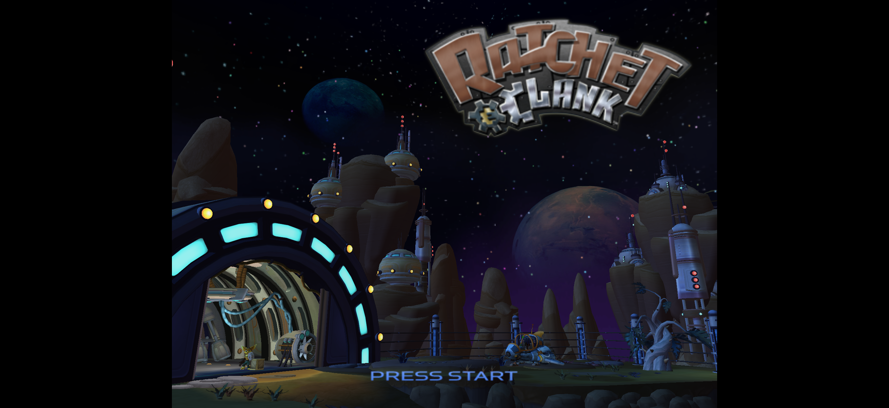

<h1 align="center">OpenRAC for iPhone and iPad</h1>

  <strong>Ratchet &amp; Clank on your iPhone and iPad, running natively.</strong> 
  The PS2 game, decompiled back into C and built for iOS with Metal. Not an emulator.

  
  

  <a href="#install">Install</a> ·
  <a href="port/ios/README.md">Build it yourself</a> ·
  <a href="#add-your-game">Add your game</a> ·
  <a href="#playing">Playing</a> ·
  <a href="#credits">Credits</a>

  

## What is this?

This is an iPhone and iPad port of [OpenRAC](https://github.com/OpenRAC/OpenRAC). It runs the actual game code natively on your device. No emulator involved.

- **Works now:** Ratchet & Clank (NTSC, `SCUS_971.99`)
- **Not yet:** the other games and the PAL version
- **Tested on:** iPhone 16 Pro and iPad Pro 11-inch (M4), at 60fps
- **Game files are not included.** You bring your own disc and the app sets it up on your device

Same idea as SpeedBreaker. You get the app, give it your copy of the game, and it does the rest.

## Install

It's not on the App Store. There are two ways to get it on your iPhone or iPad:

- **Build it yourself (recommended).** Build it on a Mac and install it signed with your own Apple ID. It's one command, and it works over Wi-Fi once your device is paired. This is how it was tested. [port/ios/README.md](port/ios/README.md) walks you through it.
- **Sideload the IPA (experimental).** Every release has an IPA, `OpenRAC_rac1-ntsc_<version>_ios.ipa`, on the [release page](https://github.com/SubhanHabib/OpenRAC-iOS/releases/latest). Install it with [AltStore](https://altstore.io), [SideStore](https://sidestore.io) or [Sideloadly](https://sideloadly.io), which sign it with your Apple ID. Heads up: it installs on an iPad when it's re-signed the way those tools do it, but it hasn't been tried through the tools themselves yet. If you try it, let me know how it went, and say which device and tool you used.

Either way you need iOS 17 or newer. On a free Apple ID the app stops opening after 7 days. Build it again or re-sign it with the same tool, and your saves and game data stay.

## Add your game

You need a disc image of Ratchet & Clank (NTSC) as a `.iso` file, plus about 5 GB free on your device.

1. Put your `.iso` on your device (AirDrop, iCloud Drive, or the Finder all work)
2. Open OpenRAC
3. Tap **Choose disc image…** and pick your `.iso`
   - If you copied it into the app's folder (Files → On My iPhone → OpenRAC), you'll get a **Use** button for it instead
4. Wait while it builds the levels. It took about 16 minutes on an iPhone 16 Pro and 10 on an M4 iPad
5. The game starts when it's done

Keep the app open while it's working. The screen stays on by itself. If you leave the app, it carries on when you come back.

If it says it's the wrong disc, it's probably the PAL or a different version. Only NTSC works for now.

If something goes wrong, check `setup.log` in Files → On My iPhone → OpenRAC → data.

## Playing

- Hold it sideways
- Touch the screen to bring up the touch controls
- Or connect a controller: MFi, Xbox, DualShock 4 and DualSense all work

## Build it yourself

See [port/ios/README.md](port/ios/README.md). You need a Mac with Xcode and an Apple ID.

For the nerdy stuff (simulator builds, how the IPA is made, what every flag does) see [docs/port/IOS.md](docs/port/IOS.md).

## Credits

This is built on top of [OpenRAC](https://github.com/OpenRAC/OpenRAC). All the decompilation, the port and the tools that make it possible are theirs. Go give them a star.

Also uses:

- [Lombyte Project](https://github.com/lombyte-project/Lombyte), the NTSC decompilation
- [MoltenVK](https://github.com/KhronosGroup/MoltenVK), to run Vulkan on Metal
- [SDL](https://github.com/libsdl-org/SDL)
- [Python-Apple-support](https://github.com/beeware/Python-Apple-support) by BeeWare, to run the disc setup on the device

**See:** [OpenRAC's credits](https://github.com/OpenRAC/OpenRAC/blob/main/CREDITS.md) · [Licenses](LICENSE.md) · [Third-party notices](THIRD_PARTY_NOTICES.md)

This is an unofficial fan project. It isn't affiliated with or endorsed by the owners of Ratchet & Clank. All trademarks belong to their owners.
